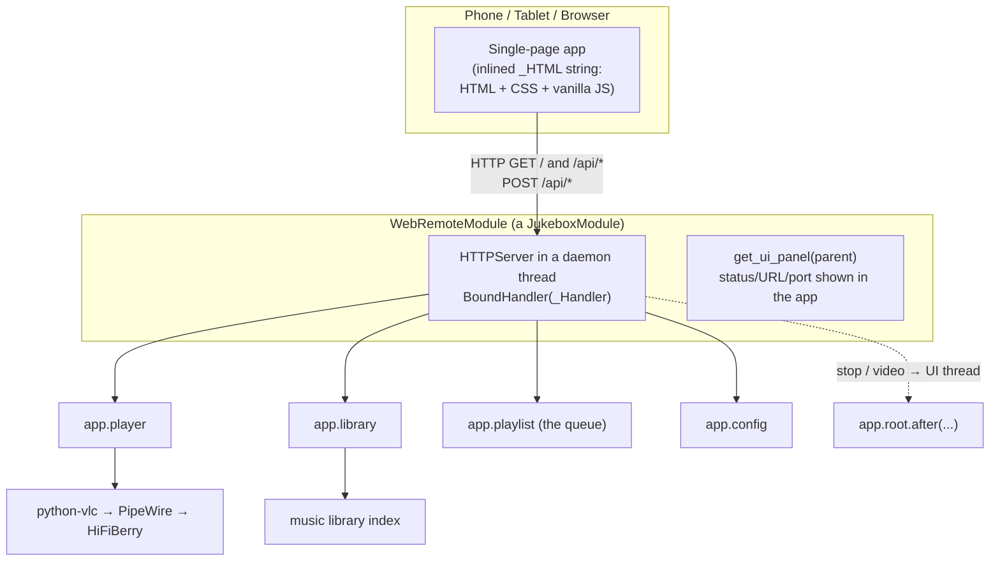
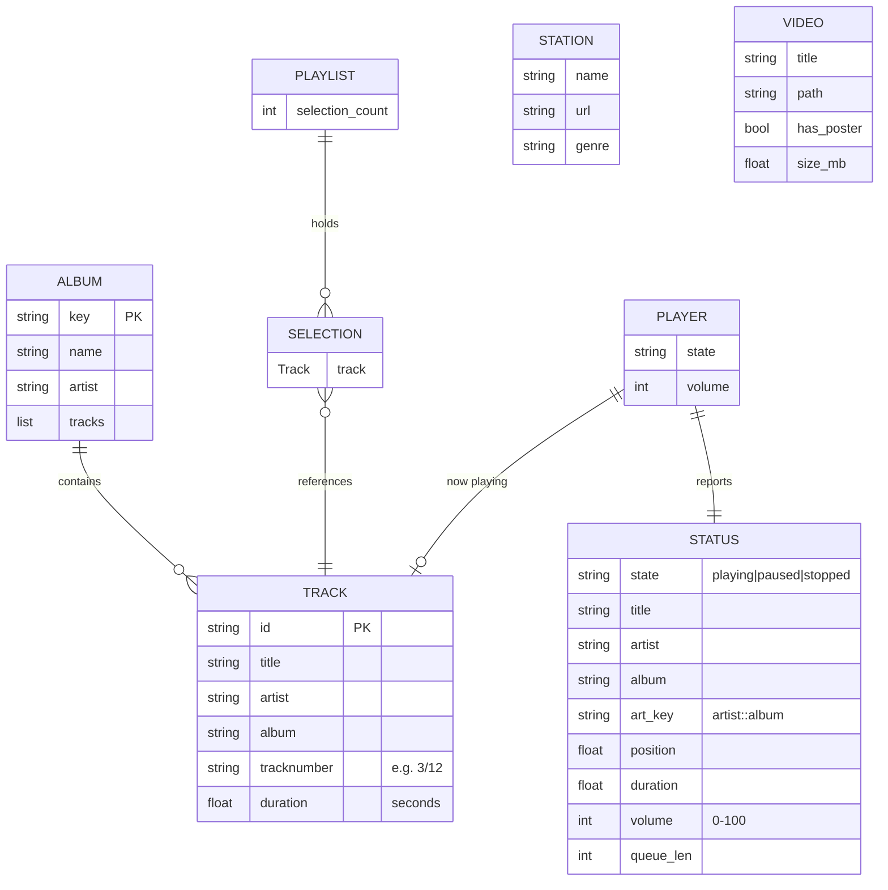

# PulseBox Web Remote — Technical Documentation

The web remote is a single PulseBox module (`modules/web_remote.py`) that runs a
lightweight HTTP server in a background thread alongside the Tkinter UI. It
serves one inlined single-page app and a small REST-like JSON API, letting any
phone, tablet, or browser on the LAN browse the library, control playback, and
manage the queue.

It has **no third-party dependencies** — only Python's built-in `http.server`,
`base64`, `socket`, and `threading`.

> Scope note: everything under *Web Remote* below is taken directly from
> `modules/web_remote.py`. The locations of the player, library, and playlist
> classes are inferred from their imports/usage and are marked *(inferred)* in
> the file tree — adjust to match your tree if they differ.

---

## 1. Architecture



Key points:

- The server runs on its **own daemon thread** (`PulseBox-WebRemote`), so it
  never blocks the Tkinter mainloop.
- The browser talks **only JSON** over `/api/*`; the one HTML payload is served
  at `/`.
- Actions that touch the GUI (stop navigates to the playlist page; video play
  opens the player) are marshalled back onto the Tkinter thread via
  `app.root.after(0, …)`.
- `APP_VERSION` is injected into the page at serve time by replacing the
  `__APP_VERSION__` placeholder in `do_GET`.

---

## 2. Entity / data model

These are the structures exchanged across the API. *Album* and *Track* are the
library's native dictionaries; *Status*, *Selection (queue item)*, *Station*,
and *Video* are shaped by the API builders.



Notes on the model:

- **`art_key`** is the string `"<artist>::<album>"`. The browser fetches
  `/api/art/<art_key>`; the server resolves it by matching artist+album across
  the library, so the same key works for both album rows and the now-playing
  art. Missing art returns a transparent placeholder, and the UI falls back to a
  gradient tile.
- **Track numbers** are stored raw as `tracknumber` (a string that may be
  `"3/12"`). `/api/library` exposes the parsed integer as `track_num`;
  `/api/album/<key>` exposes it as `track_no`. Both are sorted ascending.
- **Selection** is the queue entry; the API only surfaces `title`, `artist`,
  `album` from each pending selection's `.track`.
- **Station** comes from the radio page's fallback list, not a database.
- **Video** is produced by scanning the configured video directory.

---

## 3. File structure

```
pulsebox/
├── main.py                      # app entry point, module loader (inferred)
├── core/
│   ├── config.py                # JukeboxModule base class, APP_VERSION, config store  ✔
│   ├── player.py                # playback engine (app.player)            (inferred)
│   ├── library.py               # music library index (app.library)       (inferred)
│   ├── playlist.py              # queue / selections (app.playlist)        (inferred)
│   └── audio_spdif.py           # HiFiBerry Tx Source=AIF helper           (added earlier)
├── ui/
│   ├── theme.py                 # design tokens: ACCENT, BG_*, FONT_*, PAD ✔
│   ├── radio_page.py            # FALLBACK_STREAMS, radio UI                ✔
│   ├── video_page.py            # scan_video_library(), video UI           ✔
│   └── …                        # other Tkinter pages (playlist, etc.)
├── modules/
│   └── web_remote.py            # THIS module: HTTP server + inlined SPA    ✔
└── scripts/
    └── spdif_fix.sh             # installer fragment                       (added earlier)
```

`✔` = confirmed from imports in `web_remote.py`
(`from core.config import JukeboxModule, APP_VERSION`,
`from ui.theme import …`, `from ui.radio_page import FALLBACK_STREAMS`,
`from ui.video_page import scan_video_library`).
`(inferred)` = referenced at runtime via `app.player` / `app.library` /
`app.playlist` but the file location isn't proven by `web_remote.py` alone.

### Anatomy of `web_remote.py`

| Region | What it is |
|---|---|
| Module docstring | Human summary + a (partial) endpoint list |
| `_get_local_ip`, `_fmt_time` | Helpers |
| `_HTML = r"""…"""` | The **entire** SPA: HTML + CSS + JS, served at `/` |
| `class _Handler(BaseHTTPRequestHandler)` | Routing (`do_GET`/`do_POST`) + JSON builders |
| `class WebRemoteModule(JukeboxModule)` | Lifecycle, server management, settings panel |

---

## 4. Request lifecycle

1. The app loads the module and calls `on_load(app)`, which reads the configured
   port and starts the server thread.
2. `_start_server()` defines a `BoundHandler(_Handler)` subclass whose
   `module` class attribute back-references the live `WebRemoteModule`. That's
   how each request reaches `self.module.player`, `self.module.app`, etc.
3. A browser hits `/` → `do_GET` serves `_HTML` (with `__APP_VERSION__`
   substituted).
4. The SPA polls `GET /api/status` every second and renders library/album/radio/
   video views on demand.
5. User actions issue `POST /api/*`; handlers call into `app.player` /
   `app.playlist` and return small JSON acks.
6. GUI-affecting actions are pushed onto the Tkinter thread with
   `app.root.after(0, …)`.

---

## 5. HTTP API reference

Base URL: `http://<pi-ip>:8080` (port configurable in the module's panel).
All responses are JSON unless noted. Unknown paths return `404`.

### GET

| Path | Returns |
|---|---|
| `/` | The web remote UI (HTML). `__APP_VERSION__` is substituted with `APP_VERSION`. |
| `/api/status` | **Status** object (below). Polled ~1×/sec. |
| `/api/now` | Status **plus** `art_b64` (base64 JPEG of current art), for the now-playing view. |
| `/api/queue` | `{ "queue": [ {title, artist, album}, … ] }` — pending selections. |
| `/api/library` | `{ "albums": [Album…], "total": N }`. Each album includes its full `tracks` array (`id, title, artist, album, track_num, duration`). |
| `/api/art/<album_key>` | Album art as `image/jpeg`. `album_key` may be a library key **or** an `artist::album` string. Transparent placeholder if none. |
| `/api/album/<album_key>` | `{ "album": {name, artist, key, tracks:[{id, title, track_no, duration}]} }`. URL-decoded; tracks sorted by number. |
| `/api/radio` | `{ "stations": [{name, url, genre}, …] }` from `ui.radio_page.FALLBACK_STREAMS`. |
| `/api/videos` | `{ "videos": [{title, path, has_poster, size_mb}, …] }` from `scan_video_library(config.video_dir)`. |
| `/api/video-art/<video_path>` | Poster as `image/jpeg` when `has_poster`. |

**Status object**

```json
{
  "state": "playing|paused|stopped",
  "title": "…", "artist": "…", "album": "…",
  "art_key": "artist::album",
  "position": 42.0, "duration": 215.0,
  "volume": 55,
  "queue_len": 3
}
```

### POST

Bodies are JSON. Empty/omitted bodies are tolerated.

| Path | Body | Effect / response |
|---|---|---|
| `/api/play` | — | `player.play()` → `{ok:true}` |
| `/api/pause` | — | `player.pause()` → `{ok:true}` |
| `/api/stop` | — | `player.stop()`, then navigates the app UI to the playlist page → `{ok:true}` |
| `/api/next` | — | `player.next_track()` → `{ok:true}` |
| `/api/prev` | — | `player.previous_track()` → `{ok:true}` |
| `/api/volume` | `{volume: 0-100}` | `player.set_volume(v)` → `{ok:true, volume:v}` |
| `/api/seek` | `{position: seconds}` | `player.seek(pos)` → `{ok:true}` |
| `/api/queue/add` | `{track_id, album_key}` | adds the track to the queue → `{ok, message}` |
| `/api/queue/clear` | — | `playlist.clear_selections()` → `{ok:true}` |
| `/api/radio/play` | `{url, name}` | `player.play_url(url, title=name)` → `{ok: bool(url)}` |
| `/api/video/play` | `{path}` | opens the video on the app's screen (Tkinter thread) → `{ok: bool(path)}` |
| `/api/system/reboot` | — | `sudo reboot` in a thread → `{ok:true}` |
| `/api/system/shutdown` | — | `sudo shutdown -h now` in a thread → `{ok:true}` |

> The module's top-of-file docstring lists only a subset (it predates the radio,
> video, and system routes). This table is the authoritative list — consider
> syncing the docstring.

---

## 6. The module system

Every PulseBox feature is a subclass of `JukeboxModule` (from `core.config`).
The web remote is one such module. The contract, as exercised by
`WebRemoteModule`:

### Class metadata (class attributes)

```python
class MyModule(JukeboxModule):
    MODULE_ID          = "my_module"          # unique slug
    MODULE_NAME        = "My Module"           # display name
    MODULE_VERSION     = APP_VERSION
    MODULE_DESCRIPTION = "What it does."
    MODULE_AUTHOR      = "Andrew J. Morgan"
```

### Lifecycle methods

| Method | When | Notes |
|---|---|---|
| `__init__(self)` | construction | call `super().__init__()`, set up instance state |
| `on_load(self, app)` | module enabled | call `super().on_load(app)` first; **after that** `self.app`, `self.config`, `self.player`, `self.library` are available. Start threads/servers here. |
| `on_unload(self)` | module disabled / app exit | tear down (stop servers/threads), then `super().on_unload()` |
| `get_ui_panel(self, parent)` | settings/host view | return a `tk.Frame` (use tokens from `ui.theme`) |

### What a module can reach (via `app` / base class)

| Reference | Provides |
|---|---|
| `self.app.player` | `get_current_track()→dict\|None`, `get_state()→str`, `get_position()→float`, `get_duration()→float`, `get_volume()→int`, `play()`, `pause()`, `stop()`, `next_track()`, `previous_track()`, `set_volume(int)`, `seek(float)`, `play_url(url, title=…)` |
| `self.app.library` | `get_all_albums()→list[Album]`, `get_track(id)→Track\|None` |
| `self.app.playlist` | `selection_count`, `pending_selections` (each has `.track`), `add_selection(track)→(ok, msg)`, `clear_selections()` |
| `self.app.config` / `self.config` | `get(key, default)`, `set(key, value)` |
| `self.app.root`, `self.app.show_page(name)` | Tkinter root + page navigation (call on the UI thread via `root.after`) |

### Skeleton: a new module

```python
# modules/hello.py
import tkinter as tk
from core.config import JukeboxModule, APP_VERSION
from ui.theme import ACCENT, BG_CARD, FONT_SUBHEAD, PAD


class HelloModule(JukeboxModule):
    MODULE_ID          = "hello"
    MODULE_NAME        = "Hello"
    MODULE_VERSION     = APP_VERSION
    MODULE_DESCRIPTION = "Minimal example module."
    MODULE_AUTHOR      = "Andrew J. Morgan"

    def __init__(self):
        super().__init__()
        self._worker = None

    def on_load(self, app):
        super().on_load(app)              # self.app / self.config now set
        # start background work, register hooks, etc.

    def on_unload(self):
        # stop background work here
        super().on_unload()

    def get_ui_panel(self, parent) -> tk.Frame:
        frame = tk.Frame(parent, bg=BG_CARD, padx=PAD, pady=PAD)
        tk.Label(frame, text="Hello", font=FONT_SUBHEAD,
                 fg=ACCENT, bg=BG_CARD).pack(anchor="w")
        return frame
```

Drop the file in `modules/`, give it a unique `MODULE_ID`, and the app's module
loader will pick it up the same way it loads `web_remote`. Bump `APP_VERSION` in
`core/config.py` with each release.

---

## 7. Extending the web remote (new endpoint + tab)

Adding a feature to the remote itself is three small edits inside
`web_remote.py`.

**a) Add a route** in `_Handler.do_GET` (or `do_POST`):

```python
elif path == "/api/playlists":
    self._json(self._playlists())
```

**b) Add the builder** as a method on `_Handler`, reading from
`self.module.*` and returning a plain dict:

```python
def _playlists(self) -> dict:
    pls = self.module.app.library.get_playlists()   # your data source
    return {"playlists": [{"id": p.id, "name": p.name} for p in pls]}
```

**c) Wire the UI** inside the inlined `_HTML` JS. The data layer is already
abstracted behind two helpers, so you just call them:

```javascript
async function loadPlaylists(){
  const data = await getJSON("/api/playlists");
  // render data.playlists into a view…
}
```

To add a whole **new tab**, mirror an existing one: add a `<div class="view"
data-tab="playlists">` block, a `<button class="tab" data-tab="playlists"
onclick="showTab('playlists')">` in `#tabbar`, an optional per-tab colour rule
(`.tab[data-tab="playlists"]{…}`), and a loader call in the init block at the
bottom of the script. `showTab()` handles activation generically.

> Keep responses small and JSON-only; stream images through their own
> `image/*` endpoints (as `/api/art` and `/api/video-art` do) rather than
> embedding them in JSON, except the deliberate `art_b64` in `/api/now`.

---

## 8. Threading & safety notes

- The HTTP server is a **daemon thread**; it dies with the app. `on_unload`
  calls `server.shutdown()` to stop it cleanly on module disable.
- Handlers run on server threads. Reads of player/library state are fine;
  anything that manipulates Tkinter widgets must be deferred with
  `app.root.after(0, …)` (see `/api/stop` and `/api/video/play`).
- `reboot`/`shutdown` shell out to `sudo` in a throwaway thread so the HTTP
  response returns before the system goes down.
- Access is unauthenticated and LAN-trusted by design — keep the port on a
  trusted network.

---

*Generated against `modules/web_remote.py` at the current `APP_VERSION`. The
player/library/playlist file locations are inferred from usage; everything in
the Web Remote sections is read directly from the module source.*
